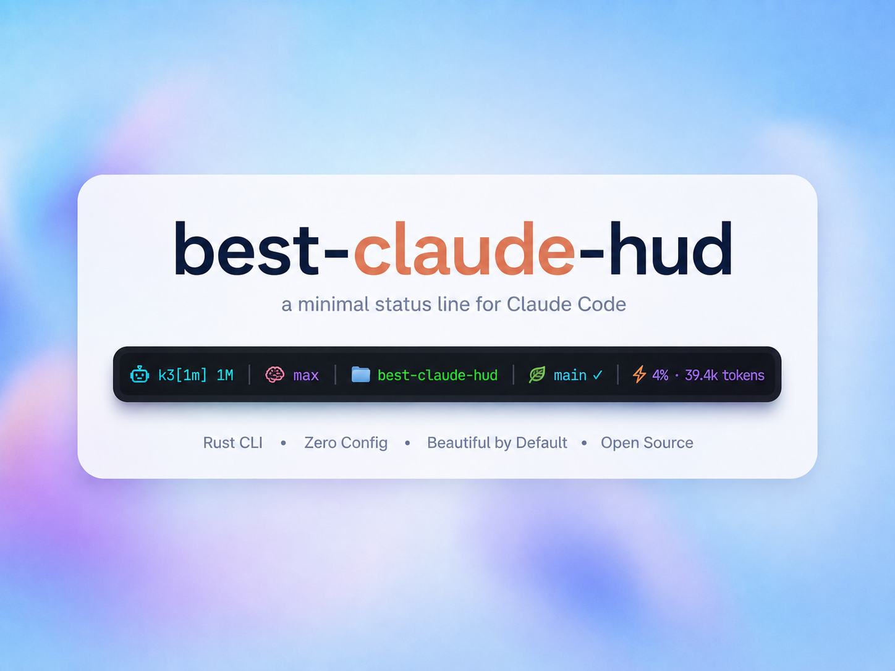
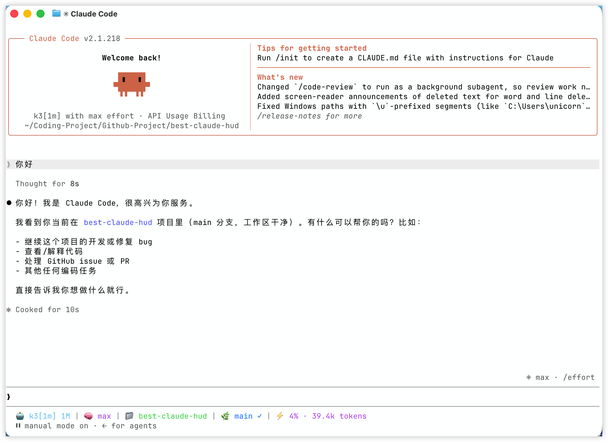

<h4 align="right"><strong><a href="./README.md">English</a></strong> | <a href="./README_CN.md">简体中文</a> | <a href="./README_JA.md">日本語</a></h4>

<p align="center">
  <a href="https://github.com/GaoSSR/best-claude-hud">
    
  </a>
</p>


---

<p align="center">
  
  
  
  
  <a href="https://codeguilds.dev/packages/best-claude-hud"></a>
</p>

<p align="center">
  <a href="https://github.com/GaoSSR/best-claude-hud"></a>
  <a href="https://www.npmjs.com/package/best-claude-hud"></a>
  <a href="https://gittrend.io/repo/GaoSSR/best-claude-hud"></a>
  <a href="https://ossinsight.io/analyze/GaoSSR/best-claude-hud"></a>
  <a href="https://github.com/fhan235/github1K/blob/3e055d2ca990cf1cd7748b9cf1fb91710f0b0cdb/reports/summary-1k-2026-07-26_created-since-2020-01-01.md"></a>
</p>

<p align="center">
  <a href="https://gitcode.com/GaoSSR/best-claude-hud"></a>
</p>

## best-claude-hud Overview


<p align="center">
  
</p>

The default statusline focuses on:

- Claude model display with live reasoning effort when available
- Git branch, clean/dirty/conflict state, and ahead/behind counts
- optional usage/rate-limit, cost, session, and output style segments

## Install

`best-claude-hud` is distributed through npm. The npm package uses prebuilt native binaries; users do not need Rust installed.


```bash
npm install -g best-claude-hud@latest && best-claude-hud --setup
```


Install only:

```bash
npm install -g best-claude-hud@latest
```

Using yarn or pnpm:

```bash
yarn global add best-claude-hud@latest
pnpm add -g best-claude-hud@latest
```

For users in China:

```bash
npm install -g best-claude-hud@latest --registry https://registry.npmmirror.com && best-claude-hud --setup
```

Update an existing installation:

```bash
npm install -g best-claude-hud@latest
```

Uninstall:

```bash
npm uninstall -g best-claude-hud
```

## Nix

`best-claude-hud` also ships a Nix flake for declarative and reproducible environments.

Run without installing globally:

```bash
nix run github:GaoSSR/best-claude-hud -- --help
```

Install into a Nix profile:

```bash
nix profile install github:GaoSSR/best-claude-hud
best-claude-hud --setup
```


Development shell:

```bash
nix develop
```

## Commands


## Themes

Temporarily override the configured theme:

```bash
best-claude-hud --theme cometix
best-claude-hud --theme minimal
best-claude-hud --theme gruvbox
best-claude-hud --theme nord
best-claude-hud --theme powerline-dark
best-claude-hud --theme powerline-light
best-claude-hud --theme powerline-rose-pine
best-claude-hud --theme powerline-tokyo-night
```

Custom themes can be stored under:


Then use:

```bash
best-claude-hud --theme my-custom-theme
```

## Configuration

Configuration files are stored under:


Important files:

- `config.toml`: main HUD and segment configuration
- `models.toml`: model display names and context window limits
- `themes/*.toml`: custom theme presets
- `.api_usage_cache.json`: optional usage API cache
- `.update_state.json`: update-check state

Run the TUI configurator:

```bash
best-claude-hud --config
```

Available segment families:

- `model`
- `directory`
- `git`
- `context_window`
- `usage`
- `cost`
- `session`
- `output_style`
- `update`

## Model Configuration

`models.toml` is created automatically on first run:


It controls model display names and context limits. Claude model families are recognized automatically, while third-party models can be customized:

```toml
[[models]]
pattern = "kimi-k2.7"
display_name = "Kimi K2.7"
context_limit = 262144

[[models]]
pattern = "glm-5"
display_name = "GLM-5"
context_limit = 200000

[[models]]
pattern = "qwen3-coder"
display_name = "Qwen Coder"
context_limit = 256000

[[context_modifiers]]
pattern = "[1m]"
display_suffix = " 1M"
context_limit = 1000000
```

## Statusline Data


- `model`
- `effort.level`, shown as a separate item when the current model supports reasoning effort
- `transcript_path`
- `context_window`
- `cost`
- `output_style`
- `rate_limits`

The effort item follows the model name with an explicit ASCII pipe and a brain
icon, for example `Kimi K2.7 | 🧠 max`. Its label is rendered in bright purple
(`#B45CFF`). The HUD displays `low`, `medium`, `high`, `xhigh`, `max`, or
`ultracode`; Nerd Font and Powerline modes use the matching Nerd Font brain
glyph.

ordinary `xhigh` and Ultracode distinct, the HUD cross-checks successful
earlier process are ignored when a conversation is resumed. An `xhigh`
`CLAUDE_CODE_EFFORT_LEVEL` override remains compatible with Ultracode, while
provide effort data, unsupported and third-party models keep the existing


## Git Status Indicators

- `✓`: clean working tree
- `●`: dirty working tree
- `⚠`: conflicts
- `↑n`: commits ahead of upstream
- `↓n`: commits behind upstream

Git commands run with `--no-optional-locks`, so the HUD does not create unnecessary `.git/index.lock` contention while you work.

## Platform Support

| Platform | Native binary source | Status |
| --- | --- | --- |
| MacOS arm64 | Native binary selected automatically by npm | Supported |
| MacOS x64 | Native binary selected automatically by npm | Supported |
| Linux x64 musl | Native binary selected automatically by npm | Supported |
| Windows x64 | Native binary selected automatically by npm | Supported |
| Linux arm64 / Windows arm64 | - | Planned |

## Requirements

- Git for branch/status display
- A terminal with ANSI color support
- A Nerd Font if you choose Nerd Font or Powerline themes

## Development

For maintainers and contributors working from source:

```bash
cargo fmt
cargo clippy -- -D warnings
cargo test
cargo build --release
cargo run -- --help
npm --prefix packaging/npm run check
npm --prefix packaging/npm run test
```

## Release

Maintainers must follow the complete, approval-gated checklist in
[RELEASING.md](./RELEASING.md). It is the source of truth for version updates,
local verification, Git tags, GitHub Releases, npm publishing, and local
installation upgrades.

## Project Resources

- [Changelog](./CHANGELOG.md)
- [Contributing guide](./CONTRIBUTING.md)
- [Release process](./RELEASING.md)
- [Security policy](./SECURITY.md)
- [Upstream triage](./docs/triage.md)

## Acknowledgements

Third-party attribution is preserved in [NOTICE](./NOTICE).

## License

Licensed under the [Apache License 2.0](./LICENSE).
