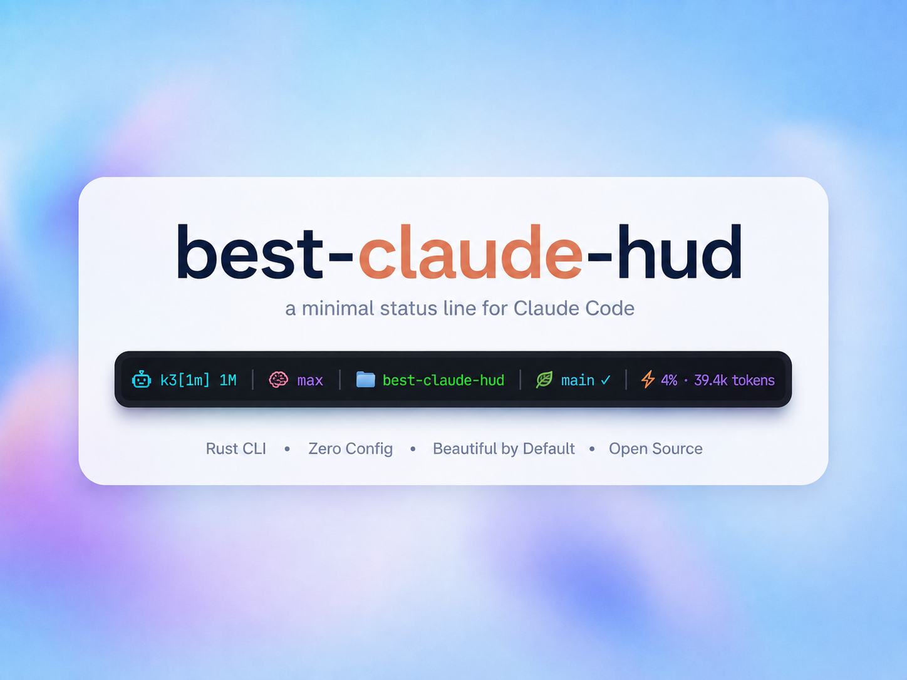
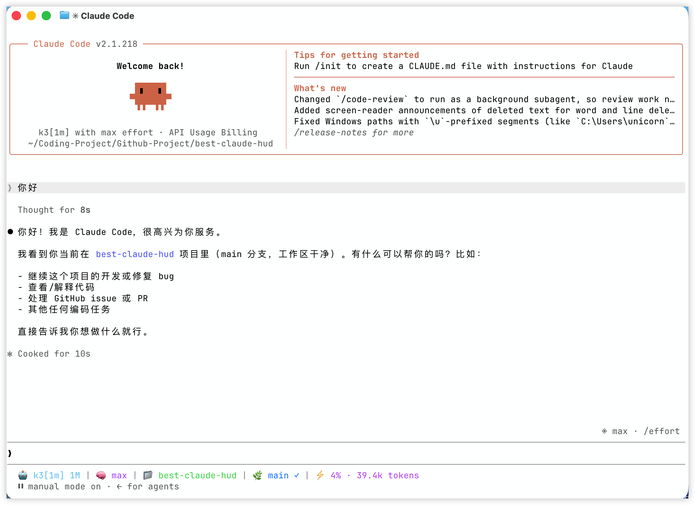

<h4 align="right"><a href="./README.md">English</a> | <strong><a href="./README_CN.md">简体中文</a></strong> | <a href="./README_JA.md">日本語</a></h4>

<p align="center">
  <a href="https://github.com/GaoSSR/best-claude-hud">
    
  </a>
</p>


---

<p align="center">
  
  
  
  
  <a href="https://codeguilds.dev/packages/best-claude-hud"></a>
</p>

<p align="center">
  <a href="https://github.com/GaoSSR/best-claude-hud"></a>
  <a href="https://www.npmjs.com/package/best-claude-hud"></a>
  <a href="https://gittrend.io/repo/GaoSSR/best-claude-hud"></a>
  <a href="https://ossinsight.io/analyze/GaoSSR/best-claude-hud"></a>
  <a href="https://github.com/fhan235/github1K/blob/3e055d2ca990cf1cd7748b9cf1fb91710f0b0cdb/reports/summary-1k-2026-07-26_created-since-2020-01-01.md"></a>
</p>

<p align="center">
  <a href="https://gitcode.com/GaoSSR/best-claude-hud"></a>
</p>

## best-claude-hud 概览


<p align="center">
  
</p>

默认状态栏关注：

- Claude 模型显示，并在可用时追加实时推理级别
- Git 分支、clean/dirty/conflict 状态和 ahead/behind 计数
- 可选的 usage/rate-limit、cost、session、output style 段落

## 安装

`best-claude-hud` 通过 npm 分发。npm 包使用预构建原生二进制，用户不需要本地安装 Rust。


```bash
npm install -g best-claude-hud@latest && best-claude-hud --setup
```


仅安装：

```bash
npm install -g best-claude-hud@latest
```

使用 yarn 或 pnpm：

```bash
yarn global add best-claude-hud@latest
pnpm add -g best-claude-hud@latest
```

国内网络可使用 npm 镜像：

```bash
npm install -g best-claude-hud@latest --registry https://registry.npmmirror.com && best-claude-hud --setup
```

更新：

```bash
npm install -g best-claude-hud@latest
```

卸载：

```bash
npm uninstall -g best-claude-hud
```

## Nix

`best-claude-hud` 也提供 Nix flake，适合声明式、可复现环境。

不全局安装，直接运行：

```bash
nix run github:GaoSSR/best-claude-hud -- --help
```

安装到 Nix profile：

```bash
nix profile install github:GaoSSR/best-claude-hud
best-claude-hud --setup
```


开发环境：

```bash
nix develop
```

## 命令


## 主题

临时覆盖当前主题：

```bash
best-claude-hud --theme cometix
best-claude-hud --theme minimal
best-claude-hud --theme gruvbox
best-claude-hud --theme nord
best-claude-hud --theme powerline-dark
best-claude-hud --theme powerline-light
best-claude-hud --theme powerline-rose-pine
best-claude-hud --theme powerline-tokyo-night
```

自定义主题目录：


然后运行：

```bash
best-claude-hud --theme my-custom-theme
```

## 配置

配置文件存放在：


关键文件：

- `config.toml`：主配置与 segment 配置
- `models.toml`：模型显示名称与 context window limit
- `themes/*.toml`：自定义主题
- `.api_usage_cache.json`：可选 usage API 缓存
- `.update_state.json`：更新检查状态

打开 TUI 配置器：

```bash
best-claude-hud --config
```

支持的 segment：

- `model`
- `directory`
- `git`
- `context_window`
- `usage`
- `cost`
- `session`
- `output_style`
- `update`

## 模型配置

`models.toml` 会在首次运行时自动创建：


它用于控制模型显示名称和上下文窗口上限。Claude 模型族会自动识别，第三方模型可以手动配置：

```toml
[[models]]
pattern = "kimi-k2.7"
display_name = "Kimi K2.7"
context_limit = 262144

[[models]]
pattern = "glm-5"
display_name = "GLM-5"
context_limit = 200000

[[models]]
pattern = "qwen3-coder"
display_name = "Qwen Coder"
context_limit = 256000

[[context_modifiers]]
pattern = "[1m]"
display_suffix = " 1M"
context_limit = 1000000
```

## 状态栏数据来源


- `model`
- `effort.level`，当前模型支持推理级别时显示为独立项目
- `transcript_path`
- `context_window`
- `cost`
- `output_style`
- `rate_limits`

推理强度项目位于模型名称后，使用明确的 ASCII 竖线和脑图标分隔，例如
`Kimi K2.7 | 🧠 max`，标签使用亮紫色 `#B45CFF` 显示。HUD 支持 `low`、
`medium`、`high`、`xhigh`、`max` 和 `ultracode`；Nerd Font 与 Powerline
模式使用对应的 Nerd Font 脑图标。

`/effort` 切换事件；恢复会话时不会继承上一个进程的 Ultracode 状态。
`CLAUDE_CODE_EFFORT_LEVEL=xhigh` 与 Ultracode 兼容，其他生效中的环境变量覆盖
静默省略，因此不支持该字段的模型和第三方模型仍保持纯模型名称显示。为了保持

字段；只有这些字段缺失、为空或暂时为零时，才回退到当前活跃 transcript。
中断响应后写入的全零 usage 占位不会清空最后一次有效读数，因此按下 `Esc`
不会让上下文占用归零。真正的新会话仍会显示 `0% · 0 tokens`，并且不会扫描
项目目录里的旧历史文件。

## Git 状态标识

- `✓`：工作树干净
- `●`：存在未提交变更
- `⚠`：存在冲突
- `↑n`：领先 upstream n 个 commit
- `↓n`：落后 upstream n 个 commit

Git 命令使用 `--no-optional-locks`，避免状态栏刷新时造成不必要的 `.git/index.lock` 竞争。

## 平台支持

| 平台 | 原生二进制来源 | 状态 |
| --- | --- | --- |
| MacOS arm64 | npm 自动选择原生二进制 | 支持 |
| MacOS x64 | npm 自动选择原生二进制 | 支持 |
| Linux x64 musl | npm 自动选择原生二进制 | 支持 |
| Windows x64 | npm 自动选择原生二进制 | 支持 |
| Linux arm64 / Windows arm64 | - | 计划中 |

## 系统要求

- Git，用于分支与状态显示
- 支持 ANSI color 的终端
- 如果使用 Nerd Font 或 Powerline 主题，需要配置 Nerd Font

## 开发

维护者与贡献者可从源码运行：

```bash
cargo fmt
cargo clippy -- -D warnings
cargo test
cargo build --release
cargo run -- --help
npm --prefix packaging/npm run check
npm --prefix packaging/npm run test
```

## 发布

维护者必须遵循 [RELEASING.md](./RELEASING.md) 中完整、带审批门禁的检查清单。
该文档是版本更新、本地验证、Git tag、GitHub Release、npm 发布和本机安装升级的
唯一流程来源。

## 项目资源

- [Changelog](./CHANGELOG.md)
- [贡献指南](./CONTRIBUTING.md)
- [发版流程](./RELEASING.md)
- [安全策略](./SECURITY.md)
- [上游 PR/Issue 接收策略](./docs/triage.md)

## 致谢

第三方版权归属保留在 [NOTICE](./NOTICE)。

## License

本项目采用 [Apache License 2.0](./LICENSE)。
