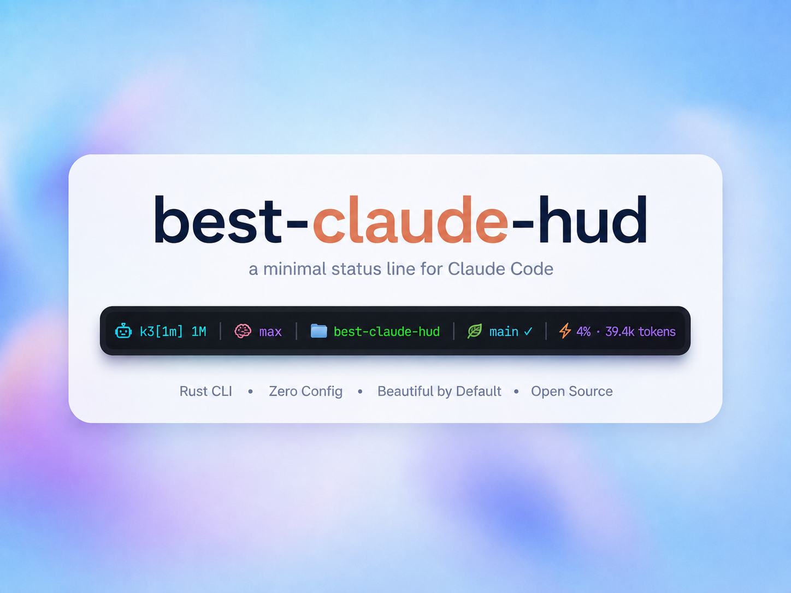
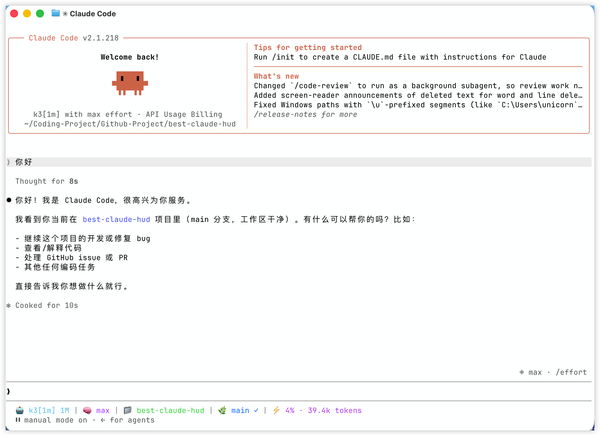

<h4 align="right"><a href="./README.md">English</a> | <a href="./README_CN.md">简体中文</a> | <strong><a href="./README_JA.md">日本語</a></strong></h4>

<p align="center">
  <a href="https://github.com/GaoSSR/best-claude-hud">
    
  </a>
</p>


---

<p align="center">
  
  
  
  
  <a href="https://codeguilds.dev/packages/best-claude-hud"></a>
</p>

<p align="center">
  <a href="https://github.com/GaoSSR/best-claude-hud"></a>
  <a href="https://www.npmjs.com/package/best-claude-hud"></a>
  <a href="https://gittrend.io/repo/GaoSSR/best-claude-hud"></a>
  <a href="https://ossinsight.io/analyze/GaoSSR/best-claude-hud"></a>
  <a href="https://github.com/fhan235/github1K/blob/3e055d2ca990cf1cd7748b9cf1fb91710f0b0cdb/reports/summary-1k-2026-07-26_created-since-2020-01-01.md"></a>
</p>

<p align="center">
  <a href="https://gitcode.com/GaoSSR/best-claude-hud"></a>
</p>

## best-claude-hud の概要


<p align="center">
  
</p>

デフォルトのステータスラインは、次の情報を重視しています。

- Claude モデル。利用可能な場合はリアルタイムの推論強度も表示
- Git ブランチ、clean/dirty/conflict 状態、ahead/behind のコミット数
- オプションの使用量とレート制限、コスト、セッション、出力スタイルの各セグメント

## インストール

`best-claude-hud` は npm を通じて配布されています。npm パッケージはビルド済みのネイティブバイナリを使用するため、ユーザーが Rust をインストールする必要はありません。


```bash
npm install -g best-claude-hud@latest && best-claude-hud --setup
```


インストールのみを行う場合:

```bash
npm install -g best-claude-hud@latest
```

yarn または pnpm を使用する場合:

```bash
yarn global add best-claude-hud@latest
pnpm add -g best-claude-hud@latest
```

中国国内のユーザー向け:

```bash
npm install -g best-claude-hud@latest --registry https://registry.npmmirror.com && best-claude-hud --setup
```

既存のインストールを更新する場合:

```bash
npm install -g best-claude-hud@latest
```

アンインストール:

```bash
npm uninstall -g best-claude-hud
```

## Nix

`best-claude-hud` は、宣言的で再現可能な環境向けに Nix flake も提供しています。

グローバルにインストールせず実行する場合:

```bash
nix run github:GaoSSR/best-claude-hud -- --help
```

Nix profile にインストールする場合:

```bash
nix profile install github:GaoSSR/best-claude-hud
best-claude-hud --setup
```


開発シェル:

```bash
nix develop
```

## コマンド


## テーマ

設定済みのテーマを一時的に上書きする場合:

```bash
best-claude-hud --theme cometix
best-claude-hud --theme minimal
best-claude-hud --theme gruvbox
best-claude-hud --theme nord
best-claude-hud --theme powerline-dark
best-claude-hud --theme powerline-light
best-claude-hud --theme powerline-rose-pine
best-claude-hud --theme powerline-tokyo-night
```

カスタムテーマは次のディレクトリに保存できます。


保存後は次のように使用します。

```bash
best-claude-hud --theme my-custom-theme
```

## 設定

設定ファイルは次のディレクトリに保存されます。


重要なファイル:

- `config.toml`: HUD とセグメントのメイン設定
- `models.toml`: モデルの表示名とコンテキストウィンドウ上限
- `themes/*.toml`: カスタムテーマのプリセット
- `.api_usage_cache.json`: オプションの使用量 API キャッシュ
- `.update_state.json`: 更新チェックの状態

TUI 設定ツールを実行する場合:

```bash
best-claude-hud --config
```

使用可能なセグメントの種類:

- `model`
- `directory`
- `git`
- `context_window`
- `usage`
- `cost`
- `session`
- `output_style`
- `update`

## モデル設定

`models.toml` は初回実行時に自動的に作成されます。


このファイルでモデルの表示名とコンテキスト上限を制御します。Claude のモデルファミリーは自動的に認識され、サードパーティ製モデルはカスタマイズできます。

```toml
[[models]]
pattern = "kimi-k2.7"
display_name = "Kimi K2.7"
context_limit = 262144

[[models]]
pattern = "glm-5"
display_name = "GLM-5"
context_limit = 200000

[[models]]
pattern = "qwen3-coder"
display_name = "Qwen Coder"
context_limit = 256000

[[context_modifiers]]
pattern = "[1m]"
display_suffix = " 1M"
context_limit = 1000000
```

## ステータスラインのデータ


- `model`
- `effort.level`: 現在のモデルが推論強度をサポートしている場合は独立した項目として表示
- `transcript_path`
- `context_window`
- `cost`
- `output_style`
- `rate_limits`

推論強度の項目はモデル名の後に続き、明示的な ASCII パイプと脳のアイコンで区切られます。たとえば `Kimi K2.7 | 🧠 max` のように表示されます。ラベルは明るい紫色（`#B45CFF`）で描画されます。HUD は `low`、`medium`、`high`、`xhigh`、`max`、`ultracode` を表示し、Nerd Font モードと Powerline モードでは対応する Nerd Font の脳グリフを使用します。


## Git の状態表示

- `✓`: clean な作業ツリー
- `●`: dirty な作業ツリー
- `⚠`: conflict あり
- `↑n`: upstream より n コミット先行
- `↓n`: upstream より n コミット遅れ

Git コマンドは `--no-optional-locks` 付きで実行されるため、HUD の動作中に不要な `.git/index.lock` の競合を発生させません。

## 対応プラットフォーム

| プラットフォーム | ネイティブバイナリの提供元 | 状態 |
| --- | --- | --- |
| MacOS arm64 | npm によりネイティブバイナリを自動選択 | 対応 |
| MacOS x64 | npm によりネイティブバイナリを自動選択 | 対応 |
| Linux x64 musl | npm によりネイティブバイナリを自動選択 | 対応 |
| Windows x64 | npm によりネイティブバイナリを自動選択 | 対応 |
| Linux arm64 / Windows arm64 | - | 対応予定 |

## 要件

- ブランチと状態の表示に使用する Git
- ANSI カラーをサポートするターミナル
- Nerd Font または Powerline テーマを選択する場合は Nerd Font

## 開発

ソースから作業するメンテナーとコントリビューター向け:

```bash
cargo fmt
cargo clippy -- -D warnings
cargo test
cargo build --release
cargo run -- --help
npm --prefix packaging/npm run check
npm --prefix packaging/npm run test
```

## リリース

メンテナーは [RELEASING.md](./RELEASING.md) に記載された、承認ゲート付きの完全なチェックリストに従う必要があります。この文書が、バージョン更新、ローカル検証、Git タグ、GitHub Releases、npm への公開、ローカル環境でのアップグレードに関する正式な手順です。

## プロジェクトリソース

- [変更履歴](./CHANGELOG.md)
- [コントリビューションガイド](./CONTRIBUTING.md)
- [リリース手順](./RELEASING.md)
- [セキュリティポリシー](./SECURITY.md)
- [アップストリームのトリアージ](./docs/triage.md)

## 謝辞

サードパーティの帰属情報は [NOTICE](./NOTICE) に保持されています。

## ライセンス

[Apache License 2.0](./LICENSE) の下でライセンスされています。
